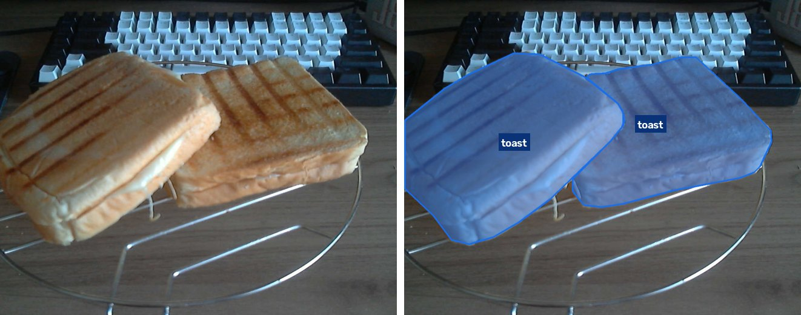
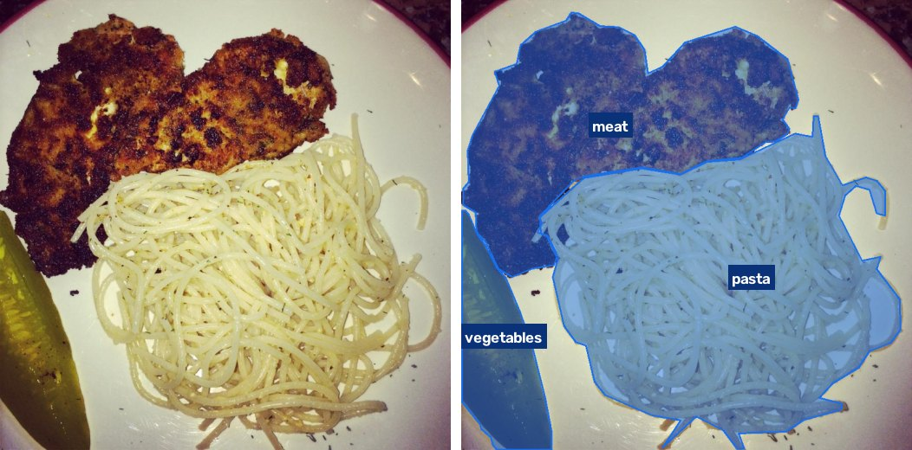
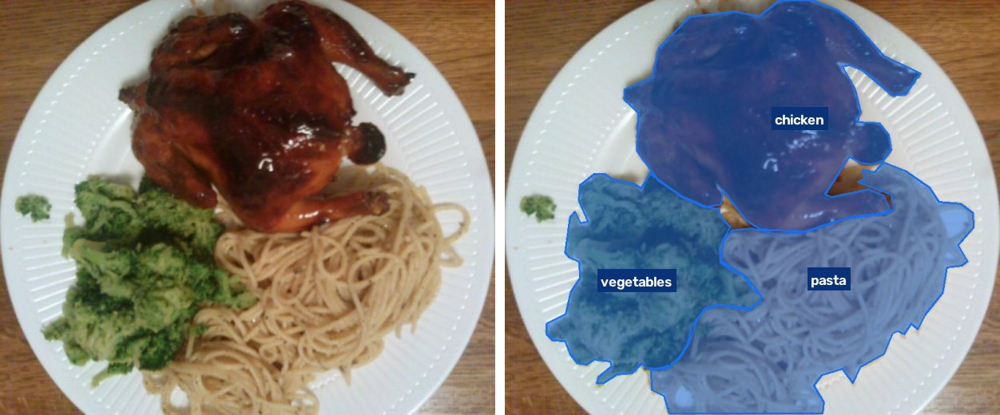
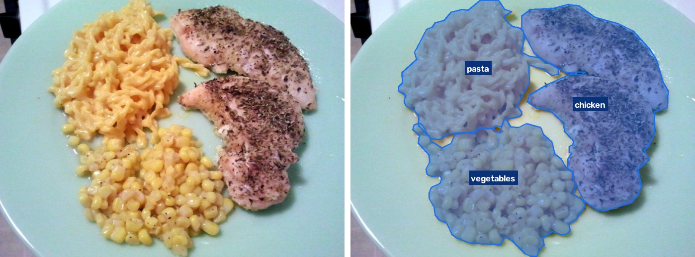

# food-cal - food components, calories and macros from a webcam

Webcam above the plate → segmentation of the food components (YOLO26-seg) → area in cm² → grams → kcal, protein/fat/carbs.
Results go to an ESP32 touch display on the desk, with a daily food diary. You can also hold the mic button and say what you ate.

## Demo

Original photo on the left, the food found by the model (`combined_v2`, 30 classes) in blue on the right.

A real frame from the webcam:



Plates with several components:







These are good cases, the model does make mistakes: test scores per class are under [Results](#results-2026-10-12-rtx-5060).
The three plates come from the FoodSeg103 test split (Apache-2.0), which the model never saw in training.

## Everyday use

- **ESP32 display** (clock in the top-left corner — synced from the PC, keeps counting while the PC is off as long
  as USB still powers the display, and the Today totals reset at midnight; PC status top right; the log line
  `Display connected ... (HELLO ... up=..s reset=..)` shows whether the display restarted meanwhile):
  - **Today** screen: date, kcal and P/F/C eaten today, number of meals. **SCAN** (touching anywhere except EDIT
    also scans; so does BOOT) and **EDIT** — today's meals, newest first, 3 per page with `<` `>`; **DELETE**
    needs two taps (DELETE → SURE?), BACK (or BOOT) returns to Today, the list closes itself after 60 s.
  - after a scan: dish name, kcal (with a range), P/F/C and three buttons — **RESCAN** (scan again; the photo
    is marked `rejected`), **CHANGE** (pick the right dish from 3 suggestions: the model's own second guesses,
    the dishes you eat most often, similar classes — the correction is saved as `01.json` next to the scan photo,
    a ready training label) and **ADD** (adds it to the diary). Without a choice the result disappears after
    60 s (thin bar above the buttons) and the Today screen returns.
  - every scan uses 4 frames and majority voting per region (`src/vote.py`) — steadier than a single frame.
  - **microphone button** (top right on Today and on a result): hold it, say what you ate (Polish is fine),
    release. Speech → text locally (faster-whisper "small" on the CPU; the audio never leaves the PC) → the text
    goes to Google Gemini (`gemini-3.8-flash`, thinking level low, 12 s limit); if Gemini fails, to `moonshotai/kimi-k3` on OpenRouter (`provider` and `fallback` in voice.yaml) — together with the nutrition
    table and typical portions → dish, kcal, P/F/C on the screen, ADD works as for a scan. Transcripts and
    answers are logged in `data/voice/`. Settings: `configs/voice.yaml`; API key: `configs/secrets.yaml`.
- No Windows notifications — results show on the display and in the tray menu only.
- **Food diary**: `data/diary.csv` (one row per meal; opens in Excel). Today's totals are computed from it.
- **Only the last 4 days are kept** (today + 3 before): older diary rows, scan photos (`*_scan`), voice logs and
  log lines are deleted for good at service start and after midnight (`src/retention.py`, `KEEP_DAYS`).
  Photos saved on purpose (`*_meal`) stay — rename a `*_scan` folder to `*_meal` to keep it.
- **Tray icon** (the ^ arrow in the bottom-right corner of the taskbar) — starts with Windows, runs in the background, no windows.
  - left click: **Scan now**
  - right click: status, today's totals, last scan, Scan now, Add last scan to today, Undo last add, Open app,
    Calibrate scale..., Open diary, Open scans folder, Open log, Start with Windows, Quit
  - color: green = display connected, orange = waiting for the display, blue = scanning
- **Web app**: tray → *Open app* (http://127.0.0.1:7860) — photo, table of components, portion correction,
  "Save to training data".
- **Calibration** (once after mounting the camera, again whenever it moves): tray → *Calibrate scale...*

From a terminal (optional):
```powershell
.venv\Scripts\python.exe src\scan_service.py --install     # start with Windows + start now
.venv\Scripts\python.exe src\scan_service.py --uninstall   # remove from startup and stop
.venv\Scripts\python.exe src\predict.py --source 0         # one scan in the console
```

## ESP32 display

Freenove ESP32 3.2" (ST7789 + touch, CH340 on COM3). Protocol and screen: `esp32/food_cal_display/food_cal_display.ino`.

- Upload firmware: `powershell -ExecutionPolicy Bypass -File esp32\upload.ps1` (stops and restarts the tray service).
- Backup of the board's original firmware (before 2026-10-12):
  `.venv\Scripts\python.exe -m esptool --port COM3 --baud 460800 write-flash 0 esp32/backup/flash_backup_20261012.bin`
- The tray service runs the model on the CPU (~0.05 s) and opens the camera only for a scan.
  Every scan saves its photo to `data/webcam/raw/<time>_scan/` — training material for later.
- Log: `runs/scan_service.log`.

## Environment

Python 3.12 in `.venv`, PyTorch 2.11 + CUDA 12.8 (required for the RTX 5060), Ultralytics 8.4.

Not in this repository: datasets, trained weights (`runs/`, `models/`), your photos and diary (`data/`) and API keys.
For voice input copy `configs/secrets.example.yaml` to `configs/secrets.yaml` and fill it in.

Recreate from scratch:
```powershell
uv venv --python 3.12 .venv
uv pip install --python .venv\Scripts\python.exe torch torchvision --index-url https://download.pytorch.org/whl/cu128
uv pip install --python .venv\Scripts\python.exe ultralytics opencv-python gradio pyarrow pandas pyyaml tqdm albumentations spandrel pyserial esptool pystray faster-whisper sounddevice
# albumentations pulls in headless OpenCV, which overwrites the normal one — without this calibrate.py and capture.py fail:
uv pip uninstall --python .venv\Scripts\python.exe opencv-python-headless
uv pip install --python .venv\Scripts\python.exe --reinstall opencv-python
# uv's pythonw.exe starts a console python.exe (a Terminal window pops up) — use CPython's windowless venv launcher:
copy %APPDATA%\uv\python\cpython-3.12-windows-x86_64-none\Lib\venv\scripts\nt\pythonw.exe .venv\Scripts\pythonw.exe
```

## Training (done on public data)

| Step | Command |
|---|---|
| FoodSeg103 → YOLO format | `python -I src/prepare_foodseg.py` |
| Food-101 → pseudo-labels for pizza, toast, pasta (YOLOE) | `python -I src/autolabel_food101.py` |
| Preview of the "webcam" augmentations | `python src/webcam_aug.py` |
| Stage 1: FoodSeg103 | `python src/train.py --name foodseg_s` |
| Stage 2: + Food-101 | `python src/train.py --data data/processed/combined.yaml --model runs/foodseg_s/weights/best.pt --epochs 30 --name combined_s` |
| Webcam robustness + enhancement models | `python src/eval_robustness.py --weights runs/combined_s/weights/best.pt` |
| FoodSeg103 with the 30-class mapping (drinks split) | `python -I src/prepare_foodseg.py --out data/processed/foodseg_yolo_v2` |
| Food-101 → pseudo-labels for burger, hot dog, burrito, dumplings | `python -I src/autolabel_food101.py --labels hamburger,hot_dog,breakfast_burrito,dumplings,gyoza --fill --out data/processed/food101_pseudo_v2 --foodseg data/processed/foodseg_yolo_v2 --combined data/processed/combined_v2.yaml --extra-sets data/processed/food101_pseudo` |
| Stage 3: 30 classes | `python src/train.py --data data/processed/combined_v2.yaml --model runs/combined_s/weights/best.pt --epochs 40 --name combined_v2` |
| Resume an interrupted run | `python src/train.py --resume --name <name>` |

Results: `runs/<name>/` (plots, `weights/best.pt`), test evaluation: `runs/<name>_test/`.

## Results (2026-10-12, RTX 5060)

**Model in use since 2026-10-13: `runs/combined_v2/weights/best.pt`** — 30 classes (stage 3 below).

### Stage 3 (2026-10-13): + burger, hot_dog, burrito, dumplings, coffee_tea, milk_drink

`combined_v2`: from `combined_s`, 40 epochs, 2.0 h. Data: FoodSeg103 with drinks split (coffee/tea, milk/milkshake,
the rest stays `drink`), Food-101 hamburger / hot_dog / breakfast_burrito / dumplings + gyoza outlined by YOLOE-26l
(prompts "hamburger", "hot dog", "tortilla wrap", "dumplings", "fried dumplings"; 600 train photos per class).
Test mask mAP50 (2208 photos):

| New class | mAP50 | | Old class | combined_s → combined_v2 |
|---|---|---|---|---|
| burger | 0.749 | | pizza | 0.826 → 0.802 |
| hot_dog | 0.642 | | toast | 0.644 → 0.641 |
| burrito | 0.630 | | pasta | 0.733 → 0.740 |
| dumplings | 0.601 | | bread | 0.557 → 0.501 |
| coffee_tea | 0.844 | | sauce | 0.436 → 0.496 |
| milk_drink | 0.561 | | drink | 0.735 → 0.546 (now only juice, soda, wine) |

Other old classes moved by at most ±0.04 (test sets differ slightly: the new Food-101 photos add bread, fries
and sauce labels). Not yet re-run: the webcam robustness test.

### Stages 1–2 (2026-10-12)

`runs/combined_s/weights/best.pt` (YOLO26s-seg, 24 classes). Mask mAP50 on the test sets:

| Test | foodseg_s (stage 1) | combined_s (stage 2) |
|---|---|---|
| FoodSeg103, clean | 0.477 | 0.457 |
| FoodSeg103, simulated webcam | 0.379 | 0.360 |
| ↳ + SCUNet / + Real-ESRGAN | 0.409 / 0.411 | 0.394 / 0.389 |
| Food-101 (pizza, toast, pasta; YOLOE outlines), clean | 0.289 | **0.670** |
| Food-101, simulated webcam | 0.269 | 0.605 |
| ↳ + SCUNet / + Real-ESRGAN | 0.250 / 0.248 | 0.615 / 0.605 |

- Stage 1: 77 epochs (early stop), 2.2 h. Stage 2: 30 epochs, 1.05 h.
- Enhancement models recover ~1/3 of the loss on FoodSeg103 and nothing on Food-101; on a real webcam frame
  SCUNet turned toasts into "sweets" — so they are only an option (`--denoise`, checkbox in the app).
- YOLO26m-seg: fits batch 3 on 8 GB, ~7–8 min/epoch (≈10 h for 80 epochs) — not worth it before collecting own photos.
- Per-class details: `runs/*_test/`, `runs/robustness_*.json` (these older outputs still use the original Polish class names).

## Fine-tuning on your photos (the biggest accuracy gain)

1. Collect meals: scans from the display/tray (deleted after 4 days — rename the ones to keep to `*_meal`),
   "Save to training data" in the app, or `python src/capture.py`.
2. `python src/autolabel_webcam.py` — pre-labels (`.json` next to the photos; scans corrected with CHANGE already have one).
3. [X-AnyLabeling](https://github.com/CVHub520/X-AnyLabeling): Open Dir → meal folder → fix outlines and classes → Ctrl+S.
4. `python src/prepare_webcam.py` — dataset split **by meal**.
5. `python src/train.py --data data/processed/webcam_yolo/data.yaml --model runs/combined_s/weights/best.pt --epochs 60 --flipud 0.5 --name webcam_s`
   (the tray service and the app pick up `webcam_s` automatically after a restart).

## Layout

```
configs/classes.yaml     classes + FoodSeg103 mapping (after a change: rerun prepare_foodseg)
configs/nutrition.yaml   kcal/protein/fat/carbs per 100 g + g/cm² factor — calibrate with labels and reference meals
configs/camera.yaml      scale px/cm (written by calibrate.py)
configs/voice.yaml       voice input: models, timeouts, whisper model, language, microphone
configs/secrets.yaml     Google and OpenRouter API keys (private, in .gitignore; template: secrets.example.yaml)
data/raw/                downloaded FoodSeg103 (Apache-2.0) and Food-101
data/processed/          YOLO-format datasets
data/webcam/raw/         your photos, one folder per meal
esp32/                   display firmware, upload script, flash backup
models/                  starting weights (YOLO26, YOLOE-26, SCUNet, Real-ESRGAN)
research/                sourced reports (nutrition values, image enhancement)
src/                     scripts
```

## Notes

- `zapiekanka` (Polish open-faced baguette) is not in any public dataset — the model learns it only from your photos.
- `toast`, `pizza`, `pasta` from Food-101 have YOLOE outlines (automatic, not hand-drawn).
- Split your own photos by meal (folder), never by single photo.
